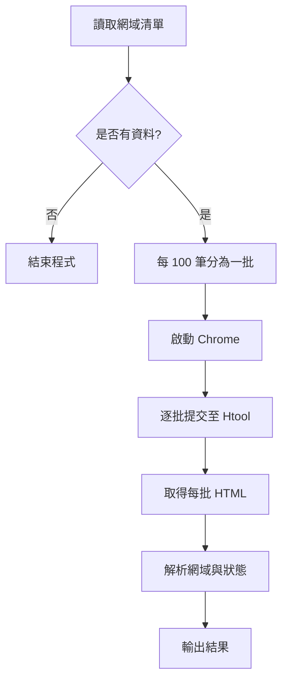

# GFW Domain Check

使用 **Python、Selenium、BeautifulSoup** 開發的批次網域檢測自動化工具。透過操作第三方 [Htool 網域檢測頁面](http://www.htool.com/domain/walls.html)，減少大量網域逐筆輸入、查詢及整理結果的人工工作。

> **注意：** 本工具擷取的是第三方網站顯示的檢測結果，並非直接從中國境內執行連線測試；結果準確性及可用性取決於該網站。

## 技術與功能

- **Python 3**：檔案讀取、清單分批及程式流程控制。
- **Selenium + Chrome**：自動開啟網站、填入網域、送出查詢及取得 HTML。
- **BeautifulSoup 4**：解析網域與對應的檢測狀態。
- **批次處理**：每批最多 100 筆，適合處理大量網域。

## 專案結構

```text
GFW-Domain-Check/
├── main.py                       # 程式入口
├── local_library.py              # GfwCheck 類別與功能實作
├── ready_to_check_fail_zones.txt # 待檢查網域（每行一筆）
└── README.md
```

## 執行流程



`main.py` 依照上述順序呼叫 `GfwCheck` 的方法，將資料處理、瀏覽器操作與 HTML 解析分開管理。

## Function 說明

### `__init__(self)`

**用途：** 初始化工作目錄，確保程式可依照 `local_library.py` 的所在位置尋找網域清單。

- 透過 `os.path.dirname(__file__)` 取得程式所在目錄。
- 使用 `os.path.abspath()` 轉成絕對路徑，儲存在 `self.work_dir`。


### `check_ready_to_check_content(self, file)`

**用途：** 確認待檢查清單不是空的，避免執行沒有意義的查詢。

1. 依工作目錄與 `file` 參數開啟文字檔。
2. 使用 List Comprehension 與 `strip()` 清除首尾空白、排除空白行。
3. 若清單為空，顯示訊息並結束程式；否則顯示可繼續執行的訊息。

**參數：** `file` — 網域清單檔名。**回傳：** 無。


### `split_domains(self, file)`

**用途：** 將大量網域分成每批最多 100 筆，避免一次提交全部資料。

1. 讀取文字檔並排除空白行。
2. 透過 `range(0, len(domains), 100)` 每次往後移動 100 筆。
3. 使用 List Slicing `domains[i:i + 100]` 擷取當前批次。
4. 將各批次加入 `urls_list` 並回傳二維 List。

**參數：** `file` — 網域清單檔名。**回傳：** `list[list[str]]`。

例如 250 筆網域會分成三批：`[100 筆, 100 筆, 50 筆]`。


### `browser_prepare(self)`

**用途：** 建立 Selenium Chrome WebDriver。

1. 建立 Options()，設定 page_load_strategy="none"，不等待整個頁面完整載入。
2. 設定 Chrome 啟動參數，降低部分 Linux／容器環境中的啟動問題：
    - `--no-sandbox`：停用 Chrome 的沙箱隔離機制。有些容器或權限受限環境可能需要，但會降低安全性；正常環境應優先保留沙箱，而非一律停用。
    - `--disable-gpu`：停用 GPU 硬體加速，讓瀏覽器不依賴部分圖形驅動功能。某些無 GPU 或圖形環境不完整的主機可能用得到，但現代 Chrome 的 Headless 模式通常不必加上。
    - `--disable-dev-shm-usage`：避免 Chrome 主要使用 /dev/shm 共享記憶體，改採其他暫存方式。常用於 Docker 等 /dev/shm 空間較小的環境，以降低瀏覽器因共享記憶體不足而崩潰的機率；可能有效能代價。
3. 使用 webdriver.Chrome(options=chrome_options) 啟動瀏覽器。

**回傳：** Chrome WebDriver 物件。`--headless` 目前為註解，預設使用可見視窗。


### `htool_domains_check(browser, urls_list)`

**用途：** 自動提交每批網域，收集網站回傳的 HTML。此方法使用 `@staticmethod`。

1. 開啟 Htool 檢測頁面；程式設計上最多嘗試三次載入。
2. 使用 `WebDriverWait` 最多等待 30 秒，確認輸入框 `searchKey` 與按鈕 `btnSearch` 出現。
3. 將每批 List 透過 `"\n".join(urls)` 轉為一行一筆的文字，再填入輸入框。
4. 等待 10 秒後點擊查詢，接著等待 30 秒。
5. 使用 `browser.page_source` 擷取 HTML、加入 `html_texts`，清空輸入框以處理下一批。
6. 全部完成後關閉瀏覽器並回傳 HTML 清單。

**參數：** `browser` — WebDriver 物件；`urls_list` — 分批後的網域清單。**回傳：** `list[str]`（各批 HTML）。


### `htool_html_text_resolve(html_texts)`

**用途：** 從 HTML 中擷取網域與檢測狀態，轉為可閱讀的結果。此方法使用 `@staticmethod`。

1. 使用 `BeautifulSoup(html_text, 'html.parser')` 解析每批 HTML。
2. 透過 CSS Selector `#wallsResult .item-result` 找出結果列。
3. 從 `.domainItem` 的 `domain` 屬性取得網域。
4. 從 `.searchResult` 擷取網站顯示的狀態文字。
5. 將每筆資料組合為 `網域 狀態`，以換行字元分隔。

**參數：** `html_texts` — HTML 字串清單。**回傳：** `str`（彙整結果）。


## 安裝與執行

**環境需求：** Python3、Google Chrome，以及與目前 Selenium 環境相容的 ChromeDriver。

```bash
pip install selenium bs4
python main.py
```

在 `ready_to_check_fail_zones.txt` 中放入網域，每行一筆：

```text
google.com
youtube.com
facebook.com
```

程式執行後，會將網站擷取的狀態列印至終端機。**目前尚未將結果寫入 CSV 或資料庫。**

> **執行前注意：** 上述指令假設檔案已命名為 `main.py`、`local_library.py`。

## 已知限制與改善方向

- **等待方式：** 目前查詢使用固定 `sleep()`；可改為等待結果元素更新，提高穩定性及效率。
- **錯誤處理：** 增加載入逾時、HTML 結構變更、查詢失敗時的處理，並確保異常時也會關閉瀏覽器。
- **結果保存：** 後續可新增 CSV／JSON 匯出、失敗批次重試及執行日誌。
- **程式整理：** 新增可用的變數與匯入，清理未使用的變數與匯入。

## 專案價值

這個專案將大量網域的人工查詢工作拆解成**輸入驗證 → 資料分批 → 瀏覽器自動化 → HTML 解析 → 結果整理**，展現 Python 在實際工作流程自動化上的應用，以及模組化與批次資料處理的實作能力。
